# Sistema de Transmissao FM VHF, Recepcao SDR e Indicador de Nivel Bargraph — TELC02A UNIFEI


Repositorio de engenharia, automacao de projeto eletronico, memorial de calculos e documentacao de bancada do sistema de transmissao em frequencia modulada e monitoramento visual de envolvente de audio desenvolvido para a disciplina **TELC02A — Telecomunicacoes II** da **Universidade Federal de Itajuba**.

---

## Identificacao Academica

| Campo | Informacao |
|---|---|
| **Instituicao** | Universidade Federal de Itajuba — UNIFEI |
| **Disciplina** | TELC02A — Telecomunicacoes II |
| **Docentes Responsaveis** | Prof. Dr. Danilo Henrique Spadoti e Prof. Dr. Mateus Augusto Faustino Chaib Junqueira |
| **Docentes e Tecnicos Colaboradores** | Prof. Dr. Decio Renno de Mendonca, Prof. Dr. Luciano Bertini e Tecnico Anderson — LPCI e LabTel |
| **Integrante 1** | Leonardo Mendonca Costa — Matricula 2024001025 |
| **Integrante 2** | Matheus Martins Venga — Matricula 2024005285 |
| **Integrante 3** | Pedro Henrique Dos Santos Barbosa — Matricula 2022013760 |
| **Integrante 4** | Pedro Henrique Oliveira Francisco — Matricula 2022003245 |
| **Relatorio Entregue** | [Relatorio Telecomunicacoes II.pdf](Relat%C3%B3rio%20Telecomunica%C3%A7%C3%B5es%20II.pdf) |

---

## Sumario

1. [Arquitetura do Sistema e Fluxo de Sinal](#1-arquitetura-do-sistema-e-fluxo-de-sinal)
2. [Fundamentacao Teorica](#2-fundamentacao-teorica)
3. [Adaptacoes de Topologia e Projeto de Esquematicos no KiCad 9.0](#3-adaptacoes-de-topologia-e-projeto-de-esquematicos-no-kicad-90)
4. [Especificacoes e Lista de Materiais](#4-especificacoes-e-lista-de-materiais)
5. [Memorial de Calculos de Engenharia](#5-memorial-de-calculos-de-engenharia)
6. [Projeto de Layout da PCB, Geometria Trapezoidal e Validacao ERC/DRC](#6-projeto-de-layout-da-pcb-geometria-trapezoidal-e-validacao-ercdrc)
7. [Processo de Fabricacao Fisica, Corrosao e Montagem das Placas](#7-processo-de-fabricacao-fisica-corrosao-e-montagem-das-placas)
8. [Ensaios de Bancada, Diagnostico de Falhas e Instrumentacao RF](#8-ensaios-de-bancada-diagnostico-de-falhas-e-instrumentacao-rf)
9. [Localizacao Diferencial da Portadora e Demodulacao WFM via RTL-SDR e SDR# Studio](#9-localizacao-diferencial-da-portadora-e-demodulacao-wfm-via-rtl-sdr-e-sdr-studio)
10. [Estrutura do Repositorio e Automacao via Scripts e Testes](#10-estrutura-do-repositorio-e-automacao-via-scripts-e-testes)
11. [Referencias Tecnicas](#11-referencias-tecnicas)

---

## 1. Arquitetura do Sistema e Fluxo de Sinal

O projeto compreende uma cadeia completa de comunicacao analogica em VHF dividida em tres subsistemas interconectados:

1. **Subsistema A — Transmissor FM VHF (`kicad/transmissor/`):** Oscilador Colpitts de estagio unico em configuracao de base comum alimentado por celula de ions de litio 18650 de $3{,}7\ \text{V}$ a $4{,}2\ \text{V}$, com atenuador resistivo de entrada P2 para nivel de linha e antena monopolo vertical acoplada diretamente ao tanque LC de coletor.
2. **Subsistema de Recepcao e Analise Espectral (`gnuradio/` e `SDR# Studio`):** Receptor de radio definido por software `RTL-SDR` equipado com controlador `RTL2832U` e sintonizador `Fitipower FC0012`, responsavel pela captura em quadratura a $2{,}048\ \text{MSPS}$, visualizacao do espectro e do espectrograma em cascata e demodulacao FM de banda larga.
3. **Subsistema B — Indicador de Nivel de Audio Bargraph (`kicad/vu_meter/`):** Mostra visual de 10 LEDs em modo barra alimentada em $9\ \text{V}$, projetada originalmente em torno do controlador logaritmico `LM3915N-1` de $3\ \text{dB/degrau}$ e validada experimentalmente tambem com o controlador linear `LM3914N` apos substituicao em bancada.

```mermaid
flowchart LR
    subgraph TX["Subsistema A: Transmissor FM VHF (Placa Corroida 46x30 mm)"]
        A1["Fonte de Audio P2\nCelular / Linha (~0,5 a 1,0 Vp)"] --> A2["Divisor Atenuador 11:1\nR1 = 10 kOhm | R5 = 1 kOhm"]
        A2 --> A3["Acoplamento AC\nC2 = 10 uF / 16 V"]
        A3 --> A4["Oscilador Colpitts Base Comum\nQ1 = PN2222A (substituto do BF494)\nC1 = 47 nF ao GND | C3 = 4,7 pF"]
        A4 --> A5["Tanque Ressonante LC\nL1 = 4 espiras | CV1 = 3-30 pF"]
        A5 --> A6["Antena Monopolo Vertical\nAE1 = 20 a 25 cm fio 20 AWG"]
    end

    subgraph CANAL["Canal Sem Fio VHF (62,810 MHz)"]
        A6 -. "Portadora WFM\nfc = 62,810 MHz\nSNR = +20,5 dB\nBW = 180 a 300 kHz" .-> B1["Antena Receptora\nDongle RTL-SDR"]
    end

    subgraph RX["Subsistema de Recepcao SDR"]
        B1 --> B2["Sintonizador Fitipower FC0012\n+ Demodulador RTL2832U\n2,048 MSPS I/Q | Ganho 7,1 dB"]
        B2 --> B3["SDR# Studio / GNU Radio\nDemodulador WFM Mono\nOffset Tuning Ativo"]
    end

    subgraph VU["Subsistema B: Bargraph VU Meter (Placa Ilhada)"]
        B3 -- "Audio Demodulado\nSaida P2" --> C1["Condicionamento de Entrada\nR2 = 1 kOhm | RP1 = 10 kOhm a 100 kOhm"]
        C1 --> C2["Comparador de 10 Niveis\nLM3915N-1 (3 dB/passo) / LM3914N\nVref = 1,25 V | R1 = 2,2 kOhm"]
        C2 --> C3["Matriz de 10 LEDs em Modo Barra\n4 Verdes | 3 Amarelos | 3 Vermelhos\nI_LED = 5,68 mA | Vcc = 9 V"]
    end
```

---

## 2. Fundamentacao Teorica

### 2.1 Modulacao em Frequencia e Regra de Carson

Na modulacao em frequencia, a frequencia instantanea da portadora varia linearmente em torno da frequencia central $\omega_c = 2\pi f_c$ proporcionalmente ao sinal modulante de mensagem $m(t)$, mantendo o envelope de amplitude $A_c$ constante:

$$s_{\text{FM}}(t) = A_c \cos\left(\omega_c t + k_f \int_{0}^{t} m(\tau)\,d\tau\right)$$

onde $k_f$ representa a sensibilidade em frequencia do modulador. O desvio maximo de frequencia $\Delta f$ em relacao a portadora e expresso por:

$$\Delta f = \frac{1}{2\pi} \max\left|\frac{d\phi(t)}{dt}\right| = \frac{k_f}{2\pi} \max|m(t)|$$

Pela Regra de Carson, a largura de banda de radiofrequencia $B_{\text{FM}}$ que concentra aproximadamente $98\%$ da potencia espectral de uma portadora modulada por um sinal com frequencia maxima $f_m$ e dada por:

$$B_{\text{FM}} = 2(\Delta f + f_m) = 2 f_m (\beta_{\text{FM}} + 1), \quad \beta_{\text{FM}} = \frac{\Delta f}{f_m}$$

### 2.2 Oscilador Colpitts em Base Comum e Modulacao Direta por Capacitancia de Juncao

No oscilador Colpitts de um unico transistor, o capacitor $C_1$ conectado entre a base e a referencia `GND` apresenta reatancia desprezivel na faixa de VHF, aterrando a base para sinais de alta frequencia. O circuito ressonante paralelo no coletor e constituido pelo indutor $L_1$ e pelo capacitor ajustavel $CV_1$. A realimentacao positiva que sustenta a oscilacao segundo o criterio de Barkhausen provem do divisor capacitivo formado por $C_3$ entre coletor e emissor e pela capacitancia interna base-emissor $C_{be}$ do transistor.

Quando o sinal de audio proveniente da entrada P2 e injetado na base por meio do capacitor eletrolitico $C_2$, a tensao coletor-base instantanea $v_{CB}(t)$ sofre variacao na taxa do sinal de audio. Essa variacao altera a largura da regiao de deplecao da juncao coletor-base, modulando sua capacitancia de transicao $C_{ob}(v_{CB})$:

$$C_{ob}(v_{CB}) = \frac{C_{ob0}}{\left(1 + \dfrac{v_{CB}}{\Psi_0}\right)^n}$$

Como $C_{ob}(v_{CB})$ encontra-se diretamente em paralelo com o tanque ressonante $L_1 \parallel CV_1$, a variacao de capacitancia produz o desvio instantaneo da frequencia de oscilacao $f_0(t)$, gerando a onda modulada em frequencia.

### 2.3 Quantizacao por Comparadores em Escada no `LM3915N-1` e `LM3914N`

Os circuitos integrados `LM3915N-1` e `LM3914N` integram uma fonte de tensao de referencia ajustavel de $1{,}25\ \text{V}$, uma cadeia divisora resistiva flutuante e 10 comparadores de tensao com saidas em coletor aberto dotadas de regulacao interna de corrente para acionamento direto de LEDs.

- No **`LM3915N-1`**, a cadeia divisora possui incrementos logaritmicos de $3\ \text{dB}$ entre comparadores adjacentes, cobrindo um intervalo dinamico de $30\ \text{dB}$ adequado a percepcao acustica humana.
- No **`LM3914N`**, utilizado como substituto funcional compativel pino a pino na etapa final de bancada, a cadeia divisora e constituida por 10 resistores iguais de $1\ \text{k}\Omega$, estabelecendo degraus lineares de $125\ \text{mV}$ para fundo de escala de $1{,}25\ \text{V}$.
- O pino 9 seleciona o modo de exibicao: quando conectado a $+V_{CC}$, habilita o modo barra, mantendo acesos todos os LEDs cujo limiar foi superado pela envolvente do sinal aplicado ao pino 5.

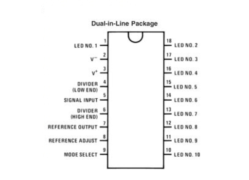

---

## 3. Adaptacoes de Topologia e Projeto de Esquematicos no KiCad 9.0

Os dois circuitos foram modelados no **KiCad 9.0.4** a partir de geradores declarativos em Python ([tools/generate_kicad.py](tools/generate_kicad.py) e [tools/kicad_sheet.py](tools/kicad_sheet.py)) sincronizados com as netlists formais em formato JSON ([netlists/transmissor_te1.json](netlists/transmissor_te1.json) e [netlists/vu_meter_lm3915.json](netlists/vu_meter_lm3915.json)).

### 3.1 Modificacoes Executadas sobre os Circuitos de Referencia

```mermaid
flowchart TD
    subgraph TX_MOD["Adaptacoes no Transmissor FM (Referencia Te1 -> Projeto TELC02A)"]
        T1["Remocao do microfone de eletreto\ne desconexao de R1 do barramento VCC"] --> T2["Insercao de conector P2 femea J1\ne divisor resistivo 11:1 (R1 = 10 kOhm, R5 = 1 kOhm)"]
        T2 --> T3["Conexao direta de C1 (47 nF)\nda Base de Q1 para a malha GND"]
        T3 --> T4["Substituicao do BF494 defeituoso pelo PN2222A\ncom adequacao da pinagem E-B-C para C-E-B"]
        T4 --> T5["Alimentacao por celula Li-Ion 18650 (3,7 a 4,2 V)\ne antena monopolo vertical de 20 a 25 cm"]
    end

    subgraph VU_MOD["Adaptacoes no Bargraph VU Meter (Referencia Ibytes -> Projeto TELC02A)"]
        V1["Reducao da tensao de alimentacao\nde 12 V para 9 V"] --> V2["Dimensionamento de R1 = 2,2 kOhm\npara limitar I_LED em 5,68 mA e P_D em 0,40 W"]
        V2 --> V3["Remocao do resistor redundante R3\nque curto-circuitava dois nos de GND no esquema original"]
        V3 --> V4["Reducao do resistor serie de entrada R2\nde 10 kOhm para 1 kOhm para ganho de sensibilidade"]
        V4 --> V5["Montagem em soquete DIP-18 permitindo\nsubstituicao imediata do LM3915N-1 pelo LM3914N"]
    end
```

### 3.2 Esquematico do Transmissor FM VHF (`kicad/transmissor/transmissor_te1.kicad_sch`)

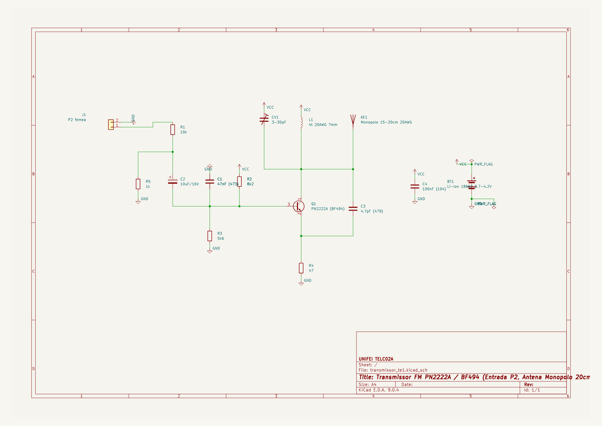

### 3.3 Esquematico do Bargraph VU Meter (`kicad/vu_meter/vu_meter_lm3915.kicad_sch`)

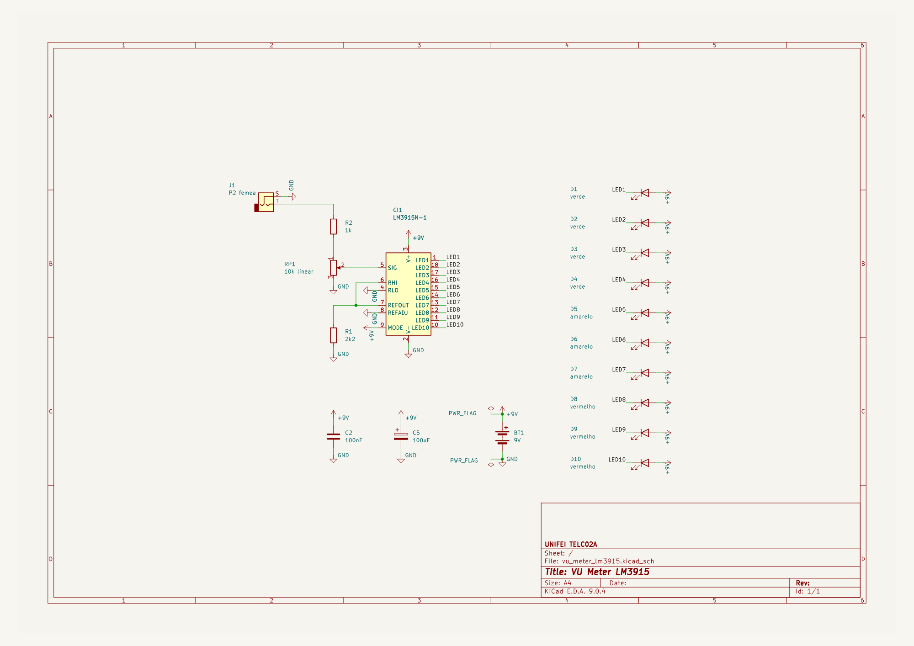

---

## 4. Especificacoes e Lista de Materiais

### 4.1 Parametros Operacionais Consolidados

| Subsistema | Parametro | Especificacao de Projeto e Medicao |
|---|---|---|
| **Transmissor FM** | Elemento ativo `Q1` | Transistor NPN `PN2222A` ($f_T = 300\ \text{MHz}$, substituto do `BF494`) |
| **Transmissor FM** | Alimentacao `BT1` | Celula Li-Ion 18650 de $3{,}7\ \text{V}$ a $4{,}2\ \text{V}$ (ensaiado em fonte ate $12\ \text{V}$) |
| **Transmissor FM** | Indutor do tanque `L1` | 4 espiras de fio de cobre esmaltado de $0{,}81\ \text{mm}$ a $1{,}0\ \text{mm}$, nucleo de ar, forma de $7\ \text{mm}$ |
| **Transmissor FM** | Capacitor de sintonia `CV1` | Trimmer ajustavel de $3\ \text{pF}$ a $30\ \text{pF}$ |
| **Transmissor FM** | Capacitor de realimentacao `C3` | Ceramico disco de $4{,}7\ \text{pF}$ (codigo EIA `479`) |
| **Transmissor FM** | Entrada de audio `J1` | Conector P2 femea com divisor atenuador $11:1$ ($-20{,}83\ \text{dB}$) |
| **Transmissor FM** | Antena `AE1` | Monopolo vertical de fio de cobre esmaltado de $20\ \text{cm}$ a $25\ \text{cm}$ |
| **Transmissor FM** | Frequencia da portadora medida | $62{,}810\ \text{MHz}$ em pausa; desvio sob modulacao entre $62{,}750\ \text{MHz}$ e $62{,}810\ \text{MHz}$ |
| **Receptor SDR** | Hardware receptor | Dongle USB `RTL-SDR` (`RTL2832U` + sintonizador `Fitipower FC0012`) |
| **Receptor SDR** | Configuracao no `SDR# Studio` | Modo `WFM` mono, filtro de $180\ \text{kHz}$ a $340\ \text{kHz}$, $2{,}048\ \text{MSPS}$, `Offset Tuning` ativo, ganho de $7{,}1\ \text{dB}$ |
| **Bargraph VU** | Circuito integrado `CI1` | `LM3915N-1` (escala logaritmica de $3\ \text{dB/passo}$) / `LM3914N` (escala linear) em soquete DIP-18 |
| **Bargraph VU** | Alimentacao e Modo | $9\ \text{V}$ DC (conector J4 / bateria) em modo barra (pino 9 em $+9\ \text{V}$) |
| **Bargraph VU** | Indicadores luminosos | 10 LEDs difusos de $5\ \text{mm}$: 4 verdes, 3 amarelos e 3 vermelhos ($I_{\text{LED}} = 5{,}68\ \text{mA}$) |

### 4.2 Lista de Materiais — Circuito A: Transmissor FM VHF

| Designador | Componente | Valor / Especificacao | Footprint KiCad | Funcao no Circuito |
|---|---|---|---|---|
| `Q1` | Transistor NPN | `PN2222A` / `BF494` (TO-92) | `Package_TO_SOT_THT:TO-92_Inline_Wide` | Oscilador Colpitts em base comum e modulador FM |
| `J1` | Conector P2 femea | $3{,}5\ \text{mm}$ stereo/mono | `Connector_PinHeader_2.54mm:PinHeader_1x02_P2.54mm_Vertical` | Entrada de sinal de audio em nivel de linha |
| `R1` | Resistor filme de carbono | $10\ \text{k}\Omega$, $1/4\ \text{W}$, $5\%$ | `Resistor_THT:R_Axial_DIN0207_L6.3mm_D2.5mm_P10.16mm_Horizontal` | Ramo serie do atenuador de entrada |
| `R5` | Resistor filme de carbono | $1\ \text{k}\Omega$, $1/4\ \text{W}$, $5\%$ | `Resistor_THT:R_Axial_DIN0207_L6.3mm_D2.5mm_P10.16mm_Horizontal` | Ramo shunt para `GND` do atenuador de entrada |
| `R2` | Resistor filme de carbono | $8{,}2\ \text{k}\Omega$, $1/4\ \text{W}$, $5\%$ | `Resistor_THT:R_Axial_DIN0207_L6.3mm_D2.5mm_P10.16mm_Horizontal` | Polarizacao superior da base (`VCC` para `BASE`) |
| `R3` | Resistor filme de carbono | $5{,}6\ \text{k}\Omega$, $1/4\ \text{W}$, $5\%$ | `Resistor_THT:R_Axial_DIN0207_L6.3mm_D2.5mm_P10.16mm_Horizontal` | Polarizacao inferior da base (`BASE` para `GND`) |
| `R4` | Resistor filme de carbono | $47\ \Omega$, $1/4\ \text{W}$, $5\%$ | `Resistor_THT:R_Axial_DIN0207_L6.3mm_D2.5mm_P10.16mm_Horizontal` | Degeneracao e estabilizacao DC de emissor |
| `C1` | Capacitor ceramico disco | $47\ \text{nF}$ (codigo `473`) | `Capacitor_THT:C_Disc_D5.0mm_W2.5mm_P5.00mm` | Desacoplamento de RF da base para `GND` |
| `C2` | Capacitor eletrolitico radial | $10\ \mu\text{F} / 16\ \text{V}$ | `Capacitor_THT:CP_Radial_D5.0mm_P2.00mm` | Bloqueio DC e acoplamento de audio para a base |
| `C3` | Capacitor ceramico disco | $4{,}7\ \text{pF}$ (codigo `479`) | `Capacitor_THT:C_Disc_D5.0mm_W2.5mm_P5.00mm` | Realimentacao positiva coletor-emissor |
| `C4` | Capacitor ceramico disco | $100\ \text{nF}$ (codigo `104`) | `Capacitor_THT:C_Disc_D5.0mm_W2.5mm_P5.00mm` | Desacoplamento de alta frequencia da bateria |
| `CV1` | Capacitor trimmer | $3\ \text{pF}$ a $30\ \text{pF}$ | `Capacitor_THT:C_Disc_D5.0mm_W2.5mm_P5.00mm` | Ajuste da frequencia de ressonancia do coletor |
| `L1` | Indutor solenoide ar | 4 espiras fio 20 AWG em $7\ \text{mm}$ | `Inductor_THT:L_Axial_L5.3mm_D2.2mm_P7.62mm_Horizontal_Vishay_IM-1` | Indutancia do circuito tanque ressonante |
| `AE1` | Antena monopolo | $20\ \text{cm}$ a $25\ \text{cm}$ fio esmaltado | `Connector_PinHeader_2.54mm:PinHeader_1x01_P2.54mm_Vertical` | Irradiacao eletromagnetica em VHF |
| `BT1` | Suporte e celula 18650 | Li-Ion $3{,}7\ \text{V}$ a $4{,}2\ \text{V}$ | `Connector_PinHeader_2.54mm:PinHeader_1x02_P2.54mm_Vertical` | Alimentacao DC do transmissor |

### 4.3 Lista de Materiais — Circuito B: Bargraph VU Meter

| Designador | Componente | Valor / Especificacao | Funcao no Circuito |
|---|---|---|---|
| `CI1` | Circuito integrado + soquete | `LM3915N-1` / `LM3914N` (DIP-18) | Driver de 10 comparadores com fonte de referencia de $1{,}25\ \text{V}$ |
| `D1` a `D4` | 4 LEDs difusos $5\ \text{mm}$ | Cor verde ($V_F \approx 2{,}0\ \text{V}$) | Indicacao dos 4 primeiros niveis de sinal |
| `D5` a `D7` | 3 LEDs difusos $5\ \text{mm}$ | Cor amarela ($V_F \approx 2{,}0\ \text{V}$) | Indicacao da faixa intermediaria de transicao |
| `D8` a `D10` | 3 LEDs difusos $5\ \text{mm}$ | Cor vermelha ($V_F \approx 1{,}9\ \text{V}$) | Indicacao de topo de escala |
| `R1` | Resistor filme de carbono | $2{,}2\ \text{k}\Omega$, $1/4\ \text{W}$, $5\%$ | Programacao da corrente de saida dos LEDs em $5{,}68\ \text{mA}$ |
| `R2` | Resistor filme de carbono | $1\ \text{k}\Omega$ (substituiu o de $10\ \text{k}\Omega$ inicial) | Limitacao de corrente em serie com a entrada P2 |
| `RP1` | Potenciometro rotativo linear | $100\ \text{k}\Omega$ (`B100K`) / $10\ \text{k}\Omega$ | Divisor ajustavel de sensibilidade para o pino 5 |
| `C2` | Capacitor ceramico disco | $100\ \text{nF}$ (codigo `104`) | Desacoplamento local junto aos pinos 2 e 3 do CI |
| `C5` | Capacitor eletrolitico radial | $100\ \mu\text{F} / 16\ \text{V}$ | Filtragem de baixa frequencia da fonte de $9\ \text{V}$ |
| `J1` | Conector P2 femea | $3{,}5\ \text{mm}$ | Entrada do sinal de audio demodulado |
| `BT1` | Conector Jack DC J4 + Fonte/Bateria | $9{,}0\ \text{V}$ DC | Alimentacao principal do circuito bargraph |

---

## 5. Memorial de Calculos de Engenharia

### 5.1 Estagio de Entrada de Audio do Transmissor (`R1`, `R5` e `C2`)

O divisor resistivo formado por $R_1 = 10\ \text{k}\Omega$ e $R_5 = 1\ \text{k}\Omega$ reduz a amplitude de linha proveniente do celular para a faixa linear de modulacao da base:

$$A_v = \frac{R_5}{R_1 + R_5} = \frac{1000}{10000 + 1000} = \frac{1}{11} \approx 0{,}0909 \quad (-20{,}83\ \text{dB})$$

Para uma tensao de entrada $V_{\text{in}} = 0{,}50\ \text{V}_{\text{pico}}$, a tensao AC entregue ao capacitor de acoplamento $C_2 = 10\ \mu\text{F}$ e $V_{\text{base(AC)}} \approx 45{,}5\ \text{mV}_{\text{pico}}$. A resistencia equivalente vista por $C_2$ combina $R_1 \parallel R_5 = 909{,}1\ \Omega$ em serie com $R_2 \parallel R_3 = 8{,}2\ \text{k}\Omega \parallel 5{,}6\ \text{k}\Omega = 3327{,}5\ \Omega$:

$$R_{\text{eq(AC)}} = 909{,}1 + 3327{,}5 = 4236{,}6\ \Omega \implies f_{c(\text{inf})} = \frac{1}{2\pi \cdot R_{\text{eq(AC)}} \cdot C_2} = \frac{1}{2\pi \times 4236{,}6 \times 10 \times 10^{-6}} \approx 3{,}76\ \text{Hz}$$

### 5.2 Polarizacao Quiescente DC do Transistor `PN2222A` (`V_CC = 4,0 V`)

Com a celula Li-Ion 18650 operando em $V_{CC} = 4{,}0\ \text{V}$:

$$V_{TH} = V_{CC} \cdot \frac{R_3}{R_2 + R_3} = 4{,}0 \times \frac{5600}{8200 + 5600} \approx 1{,}623\ \text{V}, \quad R_{TH} = \frac{8200 \times 5600}{13800} \approx 3327{,}5\ \Omega$$

Adotando $V_{BE} = 0{,}70\ \text{V}$, $\beta = 150$ e $R_4 = 47\ \Omega$:

$$I_{EQ} = \frac{V_{TH} - V_{BE}}{R_4 + \dfrac{R_{TH}}{\beta + 1}} = \frac{1{,}623 - 0{,}70}{47 + \dfrac{3327{,}5}{151}} = \frac{0{,}923}{69{,}04} \approx 13{,}37\ \text{mA}, \quad I_{CQ} \approx 13{,}28\ \text{mA}$$

$$V_E = I_{EQ} \cdot R_4 \approx 0{,}628\ \text{V}, \quad V_B = V_E + V_{BE} \approx 1{,}328\ \text{V}, \quad V_{CEQ} = V_{CC} - V_E \approx 3{,}372\ \text{V}$$

$$P_{D(\text{Q1})} = V_{CEQ} \cdot I_{CQ} = 3{,}372\ \text{V} \times 13{,}28\ \text{mA} \approx 44{,}8\ \text{mW} \ll 625\ \text{mW}, \quad g_m = \frac{I_{CQ}}{V_T} \approx 0{,}511\ \text{S}$$

### 5.3 Reatancia de Aterramento de RF da Base (`C1 = 47 nF`)

Na frequencia medida da portadora ($f_0 = 62{,}810\ \text{MHz}$), o capacitor $C_1 = 47\ \text{nF}$ entre a base e o `GND` apresenta reatancia:

$$X_{C1(\text{RF})} = \frac{1}{2\pi \cdot f_0 \cdot C_1} = \frac{1}{2\pi \times 62{,}81 \times 10^6 \times 47 \times 10^{-9}} \approx 0{,}054\ \Omega$$

garantindo o aterramento de RF da base para a topologia em base comum.

### 5.4 Indutancia `L1` (Wheeler) e Frequencia da Portadora com `PN2222A` (`62,810 MHz`)

Para o solenoide de camada unica com nucleo de ar de $N = 4$ espiras:
- **Geometria nominal sobre forma de $7{,}0\ \text{mm}$ ($d = 0{,}3075\ \text{pol}$, $l = 0{,}1378\ \text{pol}$):**
  $$L_{1(\text{nom})} = \frac{N^2 \cdot d^2}{18d + 40l} = \frac{16 \times (0{,}3075)^2}{18(0{,}3075) + 40(0{,}1378)} \approx 0{,}137\ \mu\text{H}$$
- **Geometria fisica na placa apos relaxacao mecanica da espira ($D_{\text{ef}} \approx 9{,}0\ \text{mm} = 0{,}354\ \text{pol}$, $l \approx 4{,}5\ \text{mm} = 0{,}177\ \text{pol}$) somada a indutancia parasita dos terminais ($L_{\text{par}} \approx 25\ \text{nH}$):**
  $$L_{\text{bobina}} = \frac{16 \times (0{,}354)^2}{18(0{,}354) + 40(0{,}177)} \approx 0{,}149\ \mu\text{H} \implies L_{\text{total}} = 0{,}149 + 0{,}025 = 0{,}174\ \mu\text{H}$$

A capacitancia equivalente paralela total no no do coletor ($C_{\text{total}}$) com o transistor `PN2222A` ($C_{ib} \approx 25\ \text{pF}$, $C_{ob} \approx 8{,}0\ \text{pF}$) soma:
1. **Malha de realimentacao ($C_3 = 4{,}7\ \text{pF}$ em serie com $C_{ib} = 25\ \text{pF}$):** $C_{\text{eq}} = \dfrac{4{,}7 \times 25}{4{,}7 + 25} \approx 3{,}96\ \text{pF}$
2. **Capacitancia de saida coletor-base do `PN2222A`:** $C_{ob} \approx 8{,}0\ \text{pF}$
3. **Capacitancia equivalente da antena monopolo curta (`AE1`):** $C_{\text{ant}} \approx 1{,}73\ \text{pF}$
4. **Trimmer `CV1` (`3 a 30 pF`) ajustado em $C_{V1} \approx 23{,}2\ \text{pF}$:**
   $$C_{\text{total}} = 23{,}2 + 3{,}96 + 8{,}0 + 1{,}73 = 36{,}89\ \text{pF}$$

Aplicando a formula de Thomson:

$$f_0 = \frac{1}{2\pi \sqrt{L_{\text{total}} \cdot C_{\text{total}}}} = \frac{1}{2\pi \sqrt{0{,}174 \times 10^{-6} \times 36{,}89 \times 10^{-12}}} \approx 62{,}81\ \text{MHz}$$

### 5.5 Dimensionamento Termico e Limiares do Bargraph (`LM3915N-1` e `LM3914N`)

Com os pinos 6 e 7 interligados, pino 8 em `GND` e resistor $R_1 = 2{,}2\ \text{k}\Omega$ para `GND`:

$$V_{\text{REF}} = 1{,}25\ \text{V}, \quad I_{\text{REF}} = \frac{1{,}25\ \text{V}}{2200\ \Omega} \approx 0{,}568\ \text{mA}, \quad I_{\text{LED}} \approx \frac{12{,}5\ \text{V}}{R_1} \approx 5{,}68\ \text{mA/LED}$$

Em modo barra com $V_{CC} = 9{,}0\ \text{V}$ e $V_{\text{LED}} \approx 2{,}0\ \text{V}$, a dissipacao maxima com os 10 LEDs acesos simultaneamente e:

$$P_{D(\text{max})} = 10 \cdot (V_{CC} - V_{\text{LED}}) \cdot I_{\text{LED}} = 10 \times (9{,}0 - 2{,}0) \times 0{,}00568 \approx 0{,}398\ \text{W} < 1{,}365\ \text{W (limite do DIP-18)}$$

A tabela a seguir compara os 10 limiares de acionamento no pino 5 ($V_{\text{SIG}}$) entre o controlador logaritmico original (`LM3915N-1`, passo de $-3\ \text{dB}$) e o controlador linear instalado apos a substituicao em bancada (`LM3914N`, passo de $125\ \text{mV}$):

| LED | Pino DIP-18 | Cor | Nivel `LM3915N-1` (Log) | Limiar $V_{\text{SIG}}$ no `LM3915N-1` | Proporcao `LM3914N` (Linear) | Limiar $V_{\text{SIG}}$ no `LM3914N` |
|---|---|---|---|---|---|---|
| `D1` | Pino 1 | Verde | $-27\ \text{dB}$ | $0{,}0558\ \text{V}$ ($55{,}8\ \text{mV}$) | $10\%$ | $0{,}1250\ \text{V}$ ($125{,}0\ \text{mV}$) |
| `D2` | Pino 18 | Verde | $-24\ \text{dB}$ | $0{,}0789\ \text{V}$ ($78{,}9\ \text{mV}$) | $20\%$ | $0{,}2500\ \text{V}$ ($250{,}0\ \text{mV}$) |
| `D3` | Pino 17 | Verde | $-21\ \text{dB}$ | $0{,}1114\ \text{V}$ ($111{,}4\ \text{mV}$) | $30\%$ | $0{,}3750\ \text{V}$ ($375{,}0\ \text{mV}$) |
| `D4` | Pino 16 | Verde | $-18\ \text{dB}$ | $0{,}1574\ \text{V}$ ($157{,}4\ \text{mV}$) | $40\%$ | $0{,}5000\ \text{V}$ ($500{,}0\ \text{mV}$) |
| `D5` | Pino 15 | Amarelo | $-15\ \text{dB}$ | $0{,}2223\ \text{V}$ ($222{,}3\ \text{mV}$) | $50\%$ | $0{,}6250\ \text{V}$ ($625{,}0\ \text{mV}$) |
| `D6` | Pino 14 | Amarelo | $-12\ \text{dB}$ | $0{,}3140\ \text{V}$ ($314{,}0\ \text{mV}$) | $60\%$ | $0{,}7500\ \text{V}$ ($750{,}0\ \text{mV}$) |
| `D7` | Pino 13 | Amarelo | $-9\ \text{dB}$ | $0{,}4435\ \text{V}$ ($443{,}5\ \text{mV}$) | $70\%$ | $0{,}8750\ \text{V}$ ($875{,}0\ \text{mV}$) |
| `D8` | Pino 12 | Vermelho | $-6\ \text{dB}$ | $0{,}6265\ \text{V}$ ($626{,}5\ \text{mV}$) | $80\%$ | $1{,}0000\ \text{V}$ ($1000{,}0\ \text{mV}$) |
| `D9` | Pino 11 | Vermelho | $-3\ \text{dB}$ | $0{,}8849\ \text{V}$ ($884{,}9\ \text{mV}$) | $90\%$ | $1{,}1250\ \text{V}$ ($1125{,}0\ \text{mV}$) |
| `D10` | Pino 10 | Vermelho | $0\ \text{dB}$ | $1{,}2500\ \text{V}$ ($1250{,}0\ \text{mV}$) | $100\%$ | $1{,}2500\ \text{V}$ ($1250{,}0\ \text{mV}$) |

---

## 6. Projeto de Layout da PCB, Geometria Trapezoidal e Validacao ERC/DRC

O layout da placa do transmissor ([kicad/transmissor/transmissor_te1.kicad_pcb](kicad/transmissor/transmissor_te1.kicad_pcb)) foi sintetizado programaticamente via API `pcbnew` do KiCad 9.0 ([tools/generate_pcb.py](tools/generate_pcb.py)) obedecendo aos seguintes criterios de compatibilidade eletromagnetica e manufaturabilidade por corrosao quimica:

1. **Dimensoes e Camada:** Placa de face simples na camada inferior de cobre (`B.Cu`) com contorno externo `Edge.Cuts` de exatamente $46{,}0 \times 30{,}0\ \text{mm}$.
2. **Geometria Trapezoidal a 45/135 Graus (Zero Angulos Retos):** Todas as mudancas de direcao e derivacoes em Y foram roteadas exclusivamente com segmentos ortogonais e chanfros a $45^\circ$ e $135^\circ$. A ausencia de cantos de $90^\circ$ evita concentracao de acido durante a corrosao e reduz descontinuidades de impedancia em VHF. Essa propriedade e verificada matematicamente pelo teste automatizado `test_transmitter_pcb_tracks_are_trapezoidal_without_right_angles` em [tests/test_kicad.py](tests/test_kicad.py).
3. **Plano de Terra e Larguras de Trilha:** Toda a area livre da camada `B.Cu` foi preenchida por uma zona de cobre conectada a malha `GND` com folga de isolamento (`clearance`) de $0{,}50\ \text{mm}$ e alivio termico nos pads aterrados. As trilhas foram dimensionadas em $1{,}2\ \text{mm}$ para `VCC`, $1{,}0\ \text{mm}$ para o tanque de RF do coletor e $0{,}8\ \text{mm}$ para polarizacao e audio.

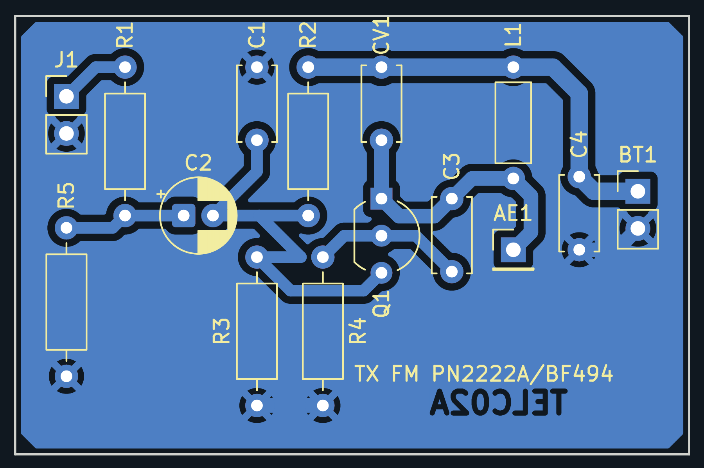

| Renderizacao 3D — Face Superior dos Componentes | Renderizacao 3D — Face Inferior de Cobre (`B.Cu`) |
|---|---|
| 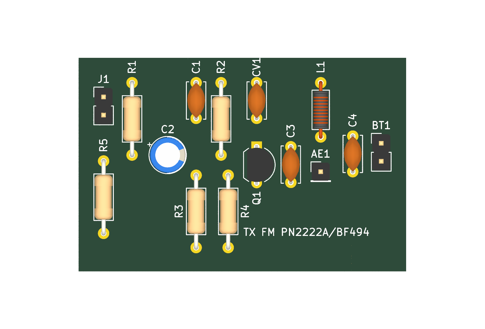 | 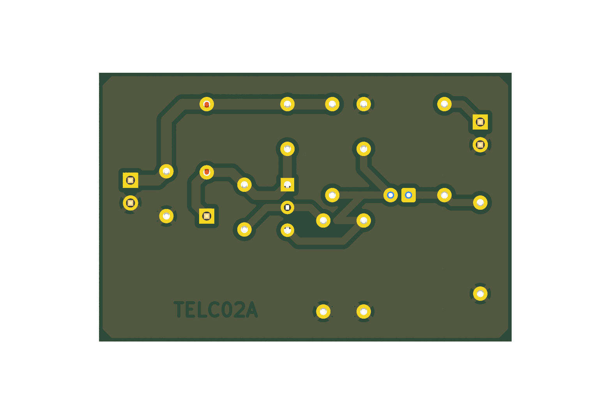 |

| Verificacao de Regras Eletricas (ERC — 0 Violacoes) | Verificacao de Regras de Layout (DRC — 0 Violacoes) |
|---|---|
| 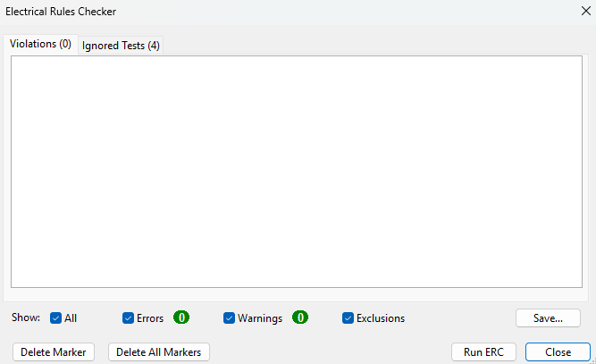 | 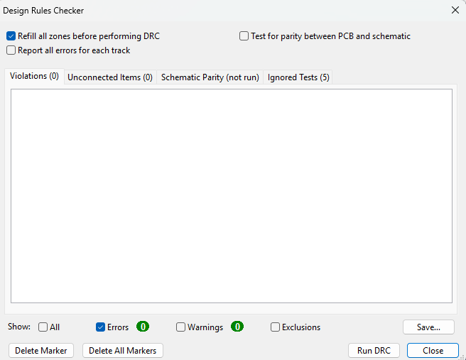 |

---

## 7. Processo de Fabricacao Fisica, Corrosao e Montagem das Placas

### 7.1 Fotolito Replicado 4x4 em Escala 1:1 e Corrosao da PCB do Transmissor

Para garantir repetibilidade no processo de transferencia termica de toner, o script [tools/generate_pcb.py](tools/generate_pcb.py) gera automaticamente o arquivo [kicad/transmissor/transmissor_te1_toner_transfer.pdf](kicad/transmissor/transmissor_te1_toner_transfer.pdf) contendo uma matriz de $4 \times 4$ copias (16 unidades em escala exata $1:1$ de $46{,}0 \times 30{,}0\ \text{mm}$, espacadas por $12{,}0\ \text{mm}$) em uma unica folha A4 paisagem. A palavra vazada `TELC02A` aparece espelhada no papel impresso (`A20CLET`) e torna-se legivel da esquerda para a direita no cobre apos a transferencia termica.

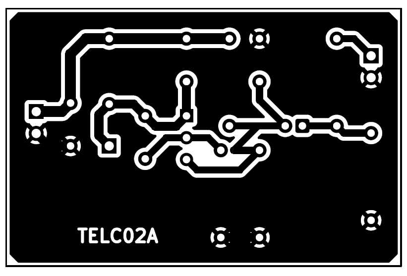

O procedimento de fabricacao do transmissor compreendeu:
1. Impressao a laser em escala $100\%$ sobre papel fotografico e corte da placa de fenolite cobreada de face simples.
2. Desoxidacao mecanica do cobre com la de aco fina e limpeza com alcool isopropilico.
3. Transferencia termica da mascara de toner com ferro de passar aquecido, seguida de imersao em agua para remocao das fibras de papel e retoque de falhas com caneta permanente preta.
4. Corrosao quimica em solucao de percloreto de ferro realizada em ambiente externo ao predio academico devido as restricoes de uso de reagentes corrosivos nos laboratorios internos.
5. Remocao do toner com solvente, furacao com broca de $1{,}0\ \text{mm}$ e soldagem dos componentes diretamente sobre a face cobreada para minimizar a indutancia parasita dos terminais em VHF, contando com o auxilio do tecnico Anderson no LPCI para a fixacao do suporte da celula 18650 e do conector P2.

| Placa do Transmissor FM Montada — Perspectiva Geral | Detalhe do Tanque LC (`L1`, `CV1`, `Q1`, `C3` e `C1` ao `GND`) | Vista Superior Completa do Transmissor |
|---|---|---|
| 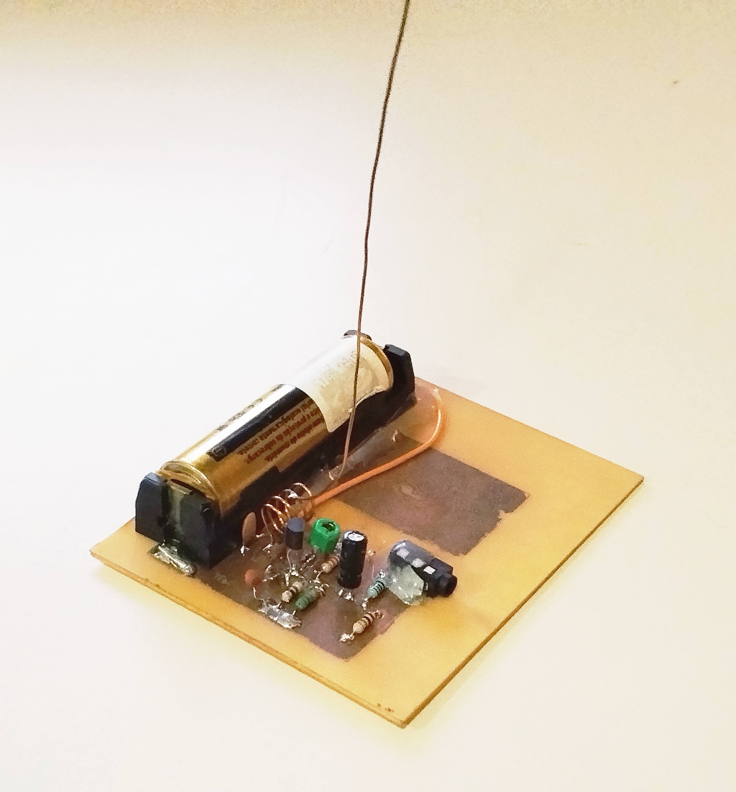 | 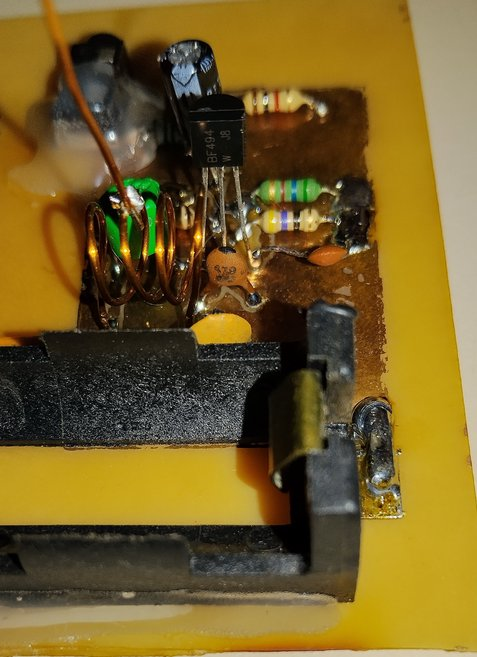 | 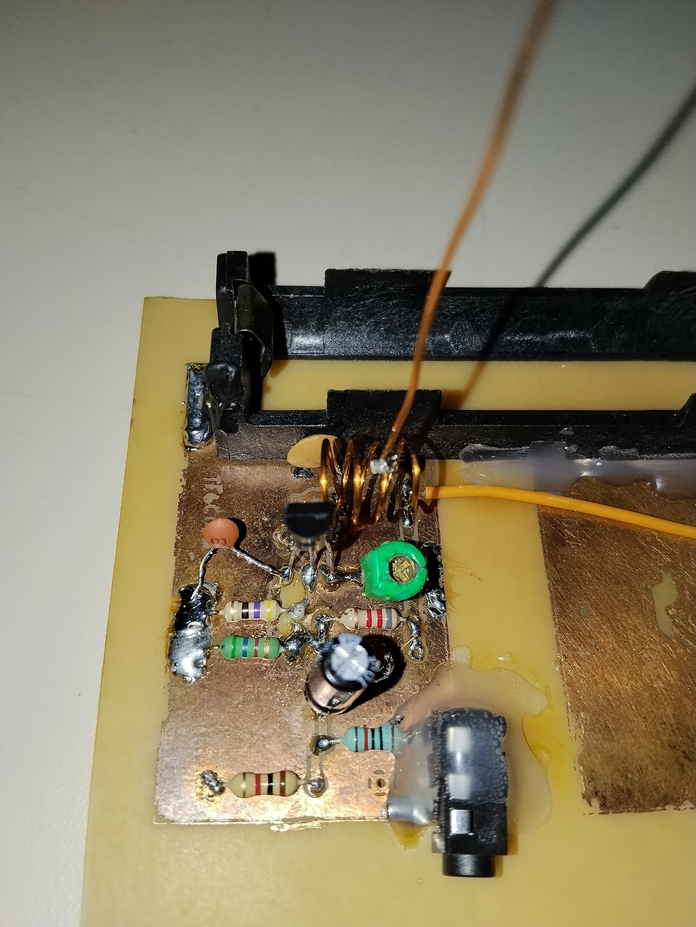 |

### 7.2 Montagem do Circuito Bargraph em Placa Perfurada Ilhada

O circuito indicador de nivel foi montado sobre uma placa de fenolite perfurada ilhada utilizando um soquete DIP-18 centralizado no lado cobreado, permitindo a substituicao do circuito integrado sem dessoldagem. Os 10 LEDs foram alinhados na borda superior com barramento comum de anodos conectado a $+9\ \text{V}$, enquanto os catodos foram roteados ponto a ponto aos pinos `1` e `18` a `10` do soquete.

| Placa Ilhada do Bargraph — Vista Superior dos Componentes | Face Inferior de Solda (Soquete DIP-18 Inicial) | Face Inferior com `LM3914N` Instalado no Soquete |
|---|---|---|
| 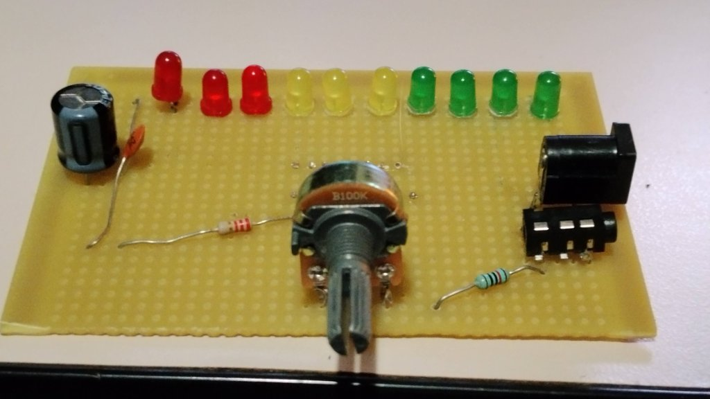 | 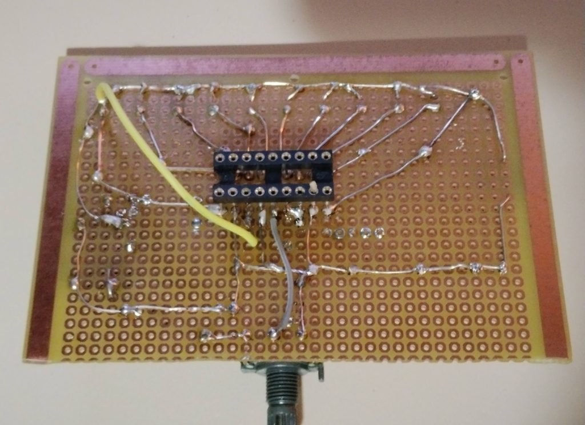 | 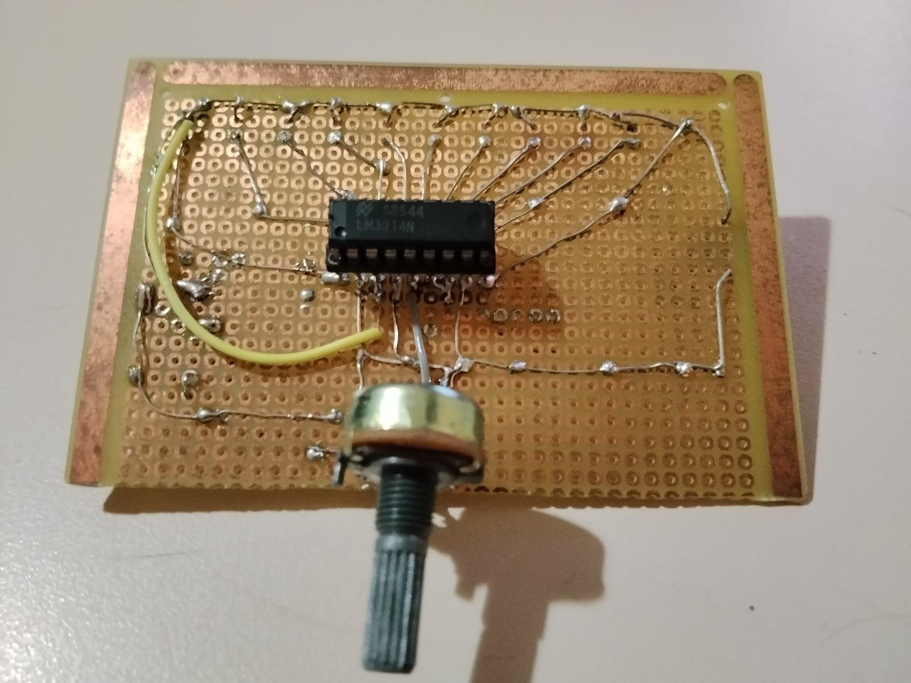 |

---

## 8. Ensaios de Bancada, Diagnostico de Falhas e Instrumentacao RF

### 8.1 Ensaios e Substituicao de Componentes no Bargraph VU Meter

1. **Ajuste de Ganho de Entrada (`R2`):** Nos ensaios iniciais do bargraph com fonte de bancada regulada em $9\ \text{V}$ e bateria de $9\ \text{V}$ com sinal de audio injetado via cabo P2, constatou-se que o resistor serie de entrada de $10\ \text{k}\Omega$ atenuava excessivamente o sinal antes do potenciometro de $100\ \text{k}\Omega$. A substituicao de $R_2$ por $1\ \text{k}\Omega$ elevou a fracao de tensao entregue ao cursor para $99\%$ com potenciometro de $100\ \text{k}\Omega$ e $90{,}9\%$ com potenciometro de $10\ \text{k}\Omega$, restabelecendo o acionamento de toda a escala luminosa.
2. **Substituicao do `LM3915N-1` pelo `LM3914N`:** Durante a intervencao na bancada para troca do potenciometro por uma unidade de menor resistencia, o exemplar do `LM3915N-1` sofreu avaria eletrica e deixou de responder ao sinal de audio no pino 5. Gracas a presenca do soquete DIP-18 na placa ilhada, o componente foi substituido imediatamente por um exemplar do `LM3914N` cedido pelo Prof. Dr. Luciano Bertini, mantendo a mesma pinagem e corrente de LED ($5{,}68\ \text{mA}$) com resposta em escala linear.

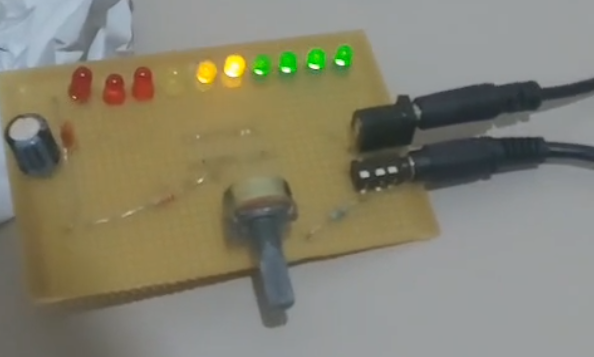

### 8.2 Diagnostico do Lote de Transistores `BF494` e Substituicao pelo `PN2222A`

Na primeira etapa de validacao de RF no Laboratorio de Telecomunicacoes (LabTel), sob orientacao do Prof. Dr. Decio Renno de Mendonca e com o uso do analisador de espectro **Rohde & Schwarz Spectrum Rider FPH**, verificou-se ausencia de portadora na faixa de $88\ \text{MHz}$ a $108\ \text{MHz}$. A inspecao em bancada com o auxilio dos tecnicos do laboratorio comprovou que o lote adquirido de transistores `BF494` encontrava-se defeituoso.

O `BF494` foi substituido pelo transistor NPN `PN2222A` ($f_T = 300\ \text{MHz}$), adequando-se a disposicao dos terminais Emissor-Base-Coletor do `PN2222A` para coincidir com as ilhas Coletor-Emissor-Base da placa.

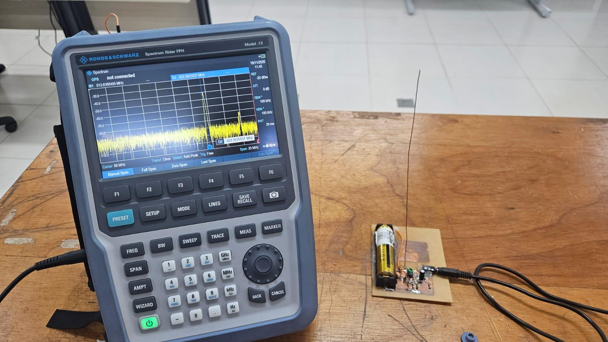

### 8.3 Ensaios Preliminares de Recepcao com GNU Radio

Para rastrear a nova frequencia de oscilacao do transmissor com o `PN2222A`, desenvolveu-se inicialmente um fluxograma de recepcao `WFM` no **GNU Radio Companion 3.10** ([gnuradio/projeto_telecomdois.grc](gnuradio/projeto_telecomdois.grc)) acoplado ao dongle `RTL-SDR`. Durante os testes em bancada, identificou-se atividade espectral proxima a $61{,}6\ \text{MHz} - 61{,}8\ \text{MHz}$ (deslocada abaixo da faixa comercial de FM pelas capacitancias internas $C_{ob} \approx 8\ \text{pF}$ e $C_{ib} \approx 25\ \text{pF}$ do `PN2222A`), porem a ausencia de espectrograma em cascata (`Waterfall`), o ganho fixo no bloco `Soapy RTLSDR Source` e a falta de filtragem passa-baixas pre-demodulacao limitaram a recuperacao nitida do audio.

| Fluxograma Desenvolvido no GNU Radio (`projeto_telecomdois.grc`) | Ensaio Pratico com RTL-SDR e GNU Radio em `61,63 MHz` |
|---|---|
| 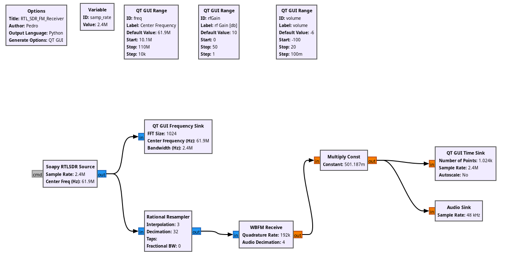 | 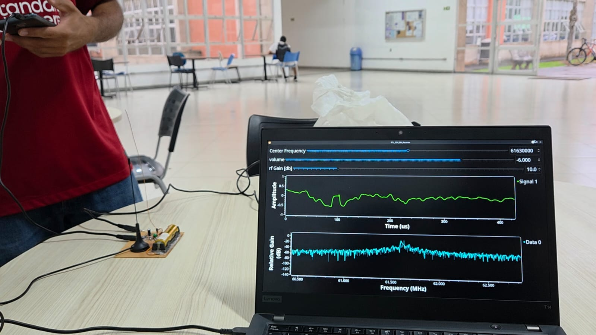 |

---

## 9. Localizacao Diferencial da Portadora e Demodulacao WFM via RTL-SDR e SDR# Studio

Para superar as limitacoes do fluxograma inicial no GNU Radio, a recepcao e o diagnostico espectral foram transferidos para o software **SDR# Studio** operando em conjunto com os utilitarios de captura de linha de comando `rtl_power` e `rtl_sdr` sobre o receptor **RTL-SDR (`RTL2832U` + sintonizador `Fitipower FC0012`)**.

### 9.1 Metodo de Subtracao Espectral Diferencial (`ON` vs. `OFF` vs. `PAUSE`)

Realizou-se uma varredura automatizada de $25\ \text{MHz}$ a $115\ \text{MHz}$ seguida de captura de amostras I/Q brutas a $2{,}4\ \text{MSPS}$ com transformada de Fourier de $32768$ pontos e cancelamento matematico de componente DC, comparando o espectro ambiental com a bateria 18650 desconectada (`OFF`) contra o espectro com a placa energizada e o audio do celular em pausa (`PAUSE`):

```text
Frequencia Medida | Diferenca (PAUSE - OFF) | Potencia em PAUSE | Piso sem Bateria (OFF) | Diagnostico
------------------+-------------------------+-------------------+------------------------+----------------------------------
   62,81000 MHz   |       +20,28 dB         |     -21,5 dBFS    |       -42,0 dBFS       | Portadora fundamental do TX FM
   62,75000 MHz   |       +15,10 dB         |     -26,9 dBFS    |       -42,0 dBFS       | Centro de desvio sob modulacao WFM
   62,00000 MHz   |        +0,05 dB         |     -25,0 dBFS    |       -25,0 dBFS       | Harmonico de clock USB (descartado)
```

### 9.2 Parametros Otimizados no `SDR# Studio` e Validacao com Musica

1. **Demodulador e Largura de Banda:** Modo `WFM` mono (`FM Stereo` e `Squelch` desativados), com largura de banda de filtro ajustada entre $180\ \text{kHz}$ e $340\ \text{kHz}$ para abranger integralmente o desvio de frequencia da portadora sem cortar os picos dinamicos de grave.
2. **Controle de Ganho e Conversor A/D:** Taxa de amostragem de $2{,}048\ \text{MSPS}$ em quadratura, `Offset Tuning` ativado para eliminar o corte do filtro DC central do sintonizador `Fitipower FC0012`, controles automaticos `RTL AGC` e `Tuner AGC` **desativados** para impedir a saturacao por campo proximo e ganho manual de RF fixado no degrau de **$7{,}1\ \text{dB}$**.
3. **Analise da Portadora em Pausa vs. Modulacao Musical:**
   - Com a reproducao do celular em **pausa**, observa-se a portadora nao modulada concentrada em **$62{,}810\ \text{MHz}$** com relacao sinal-ruido de **$+20{,}5\ \text{dB}$** acima do piso de $-42\ \text{dBFS}$ e rastro vertical estreito no espectrograma.
   - Ao iniciar a **reproducao musical** via cabo P2, observa-se a abertura simetrica das bandas laterais de modulacao em frequencia ocupando cerca de $180\ \text{kHz}$ a $300\ \text{kHz}$ entre **$62{,}750\ \text{MHz}$ e $62{,}810\ \text{MHz}$**, acompanhando a envolvente ritmica da musica e entregando o audio demodulado na saida do receptor.

| Portadora em Pausa (`62,810 MHz`, `SNR = +20,5 dB`) | Portadora Modulada com Musica via Entrada P2 (`62,750 - 62,810 MHz`) |
|---|---|
| 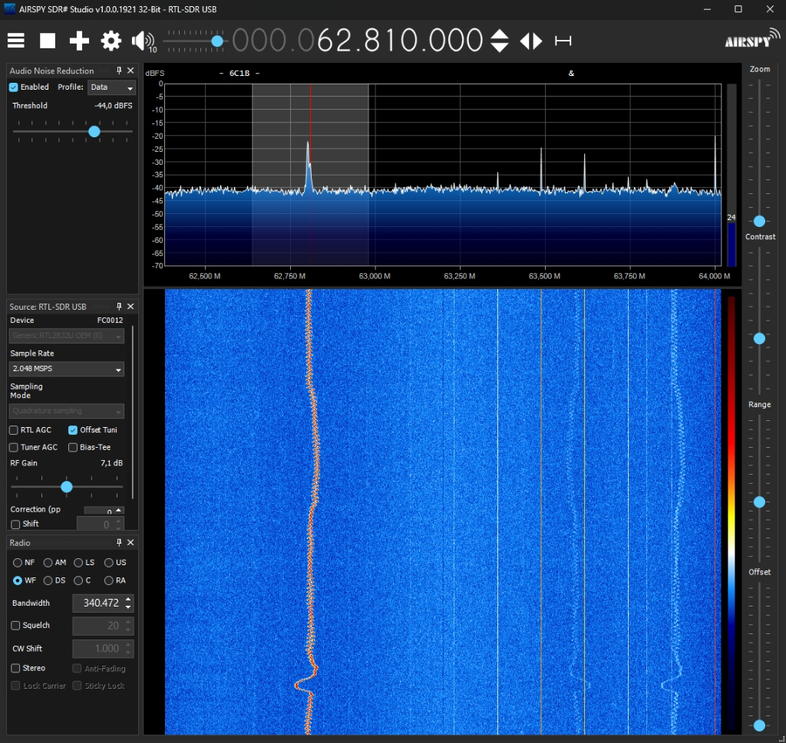 | 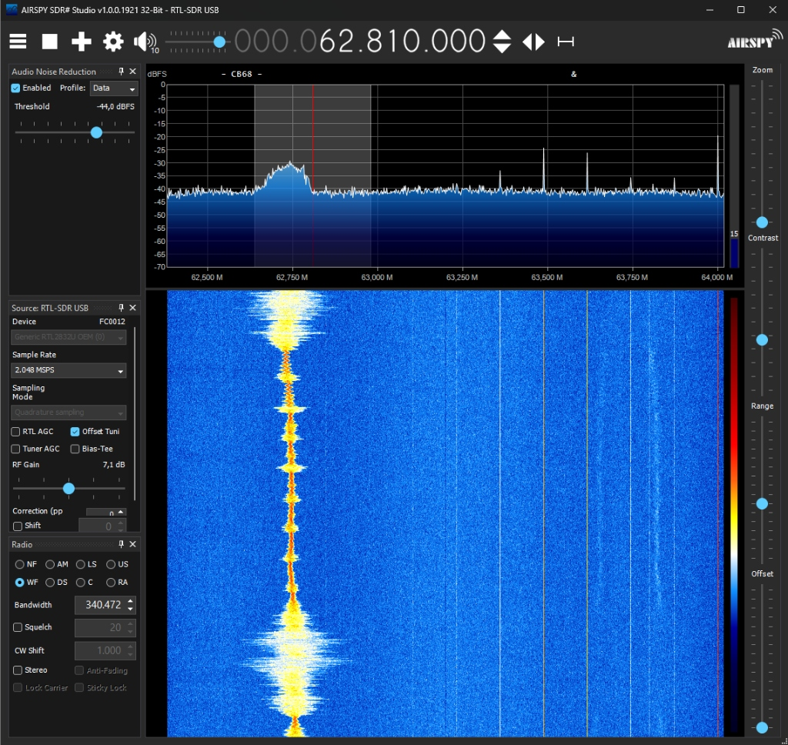 |

---

## 10. Estrutura do Repositorio e Automacao via Scripts e Testes

```text
prj/
├── README.md                                           Documentacao geral, memorial de calculos e resultados de bancada
├── Relatorio Telecomunicacoes II.pdf                   Relatorio tecnico final entregue na disciplina TELC02A
├── .gitignore                                          Filtro de arquivos temporarios do KiCad e Python
├── kicad/
│   ├── transmissor/
│   │   ├── transmissor_te1.kicad_pro                   Projeto KiCad 9.0 do Transmissor FM VHF
│   │   ├── transmissor_te1.kicad_sch                   Esquematico do Transmissor (PN2222A/BF494, Entrada P2, Li-Ion 18650)
│   │   ├── transmissor_te1.kicad_pcb                   Layout da PCB (46,0 x 30,0 mm, face simples B.Cu, trilhas a 45 graus)
│   │   ├── transmissor_te1_toner_transfer.pdf          Folha A4 com matriz 4x4 (16 copias 1:1) para transferencia termica
│   │   ├── transmissor_te1_toner_transfer_mirror.pdf   Folha A4 com matriz 4x4 (16 copias 1:1) espelhada
│   │   ├── transmissor_te1_montagem_top.pdf            Mapa superior de montagem de componentes (F.SilkS + F.Fab)
│   │   └── svg/                                        Esquematico e PCB em SVG + renderizacoes 3D (pcb_top.png, pcb_bottom.png)
│   └── vu_meter/
│       ├── vu_meter_lm3915.kicad_pro                   Projeto KiCad 9.0 do Bargraph VU Meter (LM3915N-1 / LM3914N)
│       ├── vu_meter_lm3915.kicad_sch                   Esquematico do Bargraph (9 V, modo barra, R1 = 2,2 kOhm, R2 = 1 kOhm)
│       └── svg/                                        Esquematico exportado em SVG
├── netlists/
│   ├── transmissor_te1.json                            Netlist declarativa do Transmissor FM
│   └── vu_meter_lm3915.json                            Netlist declarativa do Bargraph VU Meter
├── gnuradio/
│   └── projeto_telecomdois.grc                         Fluxograma do receptor WFM RTL-SDR para GNU Radio Companion 3.10
├── docs/
│   ├── relatorio_transmissor_fm.md                     Texto tecnico detalhado da secao de confeccao e memorial
│   ├── relatorio_figuras/                              Acervo completo de 21 figuras de alta resolucao (KiCad, PCB, fotos, SDR#)
│   ├── datasheets/
│   │   ├── bf494.pdf                                   Datasheet do transistor NPN RF BF494
│   │   └── LM3915N-1.PDF                               Datasheet oficial Texas Instruments LM3915N-1
│   └── referencias/                                    Arquivos originais de referencia (Te1 e Ibytes)
├── tools/
│   ├── generate_kicad.py                               Gerador programatico dos esquematicos KiCad 9.0
│   ├── generate_pcb.py                                 Gerador programatico da PCB e das folhas A4 com 16 copias 1:1
│   ├── kicad_sheet.py                                  Construtor S-expression para folhas de esquematico KiCad 9.0
│   ├── netlist_tools.py                                Funcoes de validacao topologica, divisores e calculos termicos
│   └── trace_copper.py                                 Extrator de conectividade por inundacao de pixels sobre imagem Gerber
└── tests/
    ├── test_kicad.py                                   Testes automatizados de ERC, DRC, paridade, geometria 45 graus e PDFs 1:1
    └── test_projeto.py                                 Testes unitarios de topologia, indutancia Wheeler, corrente e dissipacao
```

### Como Executar a Suite de Verificacao Automatizada (`20/20` Testes)

Com Python 3 e KiCad 9.0 instalados no sistema, execute na raiz do repositorio:

```powershell
python -B -m unittest discover -s tests -v
```

A suite executa `20` verificacoes automatizadas:
- **Validacao KiCad CLI (`tests/test_kicad.py`):** Paridade exata entre as netlists exportadas pelo `kicad-cli` e os arquivos `netlists/*.json`, ausencia de erros de anotacao, **0 violacoes de ERC** nos dois esquematicos, **0 violacoes de DRC e 0 trilhas desconectadas** na PCB do transmissor, **geometria 100% trapezoidal sem angulos retos de 90 graus** em todos os vertices de trilha e verificacao vetorial das **16 copias em escala exata 1:1 ($46{,}00 \times 30{,}00\ \text{mm}$)** nos PDFs de transferencia termica.
- **Validacao Fisico-Matematica (`tests/test_projeto.py`):** Integridade de pinos e redes, divisor atenuador P2 de $11:1$, realimentacao Colpitts entre coletor e emissor, rastreamento por visao computacional das ilhas de cobre, indutancia pela formula de Wheeler, corrente nos LEDs de $5{,}68\ \text{mA}$, dissipacao termica abaixo de $0{,}5\ \text{W}$ em $9\ \text{V}$ e progressao de $3\ \text{dB/passo}$.

---

## 11. Referencias Tecnicas

1. **TEXAS INSTRUMENTS.** *LM3915 Dot/Bar Display Driver Datasheet (SNVS740C)*. Dallas: Texas Instruments, 2000. Disponivel em: [docs/datasheets/LM3915N-1.PDF](docs/datasheets/LM3915N-1.PDF).
2. **PHILIPS SEMICONDUCTORS.** *BF494 NPN Medium Frequency Transistor Product Specification*. Eindhoven: Philips, 1997. Disponivel em: [docs/datasheets/bf494.pdf](docs/datasheets/bf494.pdf).
3. **JUNQUEIRA, Mateus Augusto Faustino Chaib.** *Implementacao da Modulacao em Angulo*. Itajuba: Universidade Federal de Itajuba, 2026. 51 slides. Material de aula da disciplina TELC02A — Telecomunicacoes II.
4. **TONI ELETRONICA.** *Transmissor de FM com BF494 ou BF495: facil montagem*. 2008. Acervo local em: [docs/referencias/te1/](docs/referencias/te1/).
5. **BYTES BRASIL.** *VU Meter LM3915: como montar e projetar a PCB passo a passo*. Acervo local em: [docs/referencias/vu_ibytes/](docs/referencias/vu_ibytes/).
