# Desenvolvimento e Implementação do Transmissor FM VHF

## 1. Pesquisa e Seleção da Topologia
O desenvolvimento do transmissor FM iniciou-se pela seleção de uma topologia de estágio único baseada no oscilador Colpitts em configuração de base comum, tomando como referência o circuito Te1 originalmente projetado para o transistor bipolar NPN de radiofrequência `BF494`. Nessa arquitetura, o mesmo elemento ativo realiza a geração da portadora em VHF e a modulação em frequência pela variação da capacitância de junção coletor-base em função da amplitude do sinal de áudio aplicado à base.

## 2. Adaptações do Circuito Original e Projeto do Esquemático
O circuito de referência utilizava um microfone de eletreto polarizado pela linha de alimentação por meio de um resistor conectado ao barramento positivo. Para permitir a injeção direta de sinal de áudio em nível de linha a partir de um aparelho celular, a etapa de entrada e o barramento de desacoplamento foram redesenhados no KiCad 9.0 ([transmissor_te1.kicad_sch](file:///c:/Users/alighieribot/Documents/UNIFEI/TELC02A/prj/kicad/transmissor/transmissor_te1.kicad_sch)):

1. **Estágio de Entrada de Áudio (`J1`, `R1`, `R5` e `C2`):** O microfone de eletreto foi substituído por um conector P2 fêmea de 3,5 mm. O resistor `R1` de $10\ \text{k}\Omega$ foi desconectado da linha de alimentação `VCC` e ligado em série com o terminal de sinal do conector `J1`. Um resistor `R5` de $1\ \text{k}\Omega$ foi inserido em derivação para o terra, formando um divisor resistivo com relação de atenuação de $11:1$ para evitar a saturação da junção base-emissor. O sinal atenuado é acoplado à base pelo capacitor eletrolítico `C2` de $10\ \mu\text{F} / 16\ \text{V}$.
2. **Polarização DC e Aterramento de RF da Base (`R2`, `R3`, `R4` e `C1`):** A polarização quiescente é estabelecida pelo divisor formado por `R2` de $8{,}2\ \text{k}\Omega$ e `R3` de $5{,}6\ \text{k}\Omega$, com estabilização térmica pelo resistor de emissor `R4` de $47\ \Omega$. O capacitor cerâmico `C1` de $47\ \text{nF}$ aterra a base em alta frequência diretamente para a malha `GND`.
3. **Tanque Ressonante, Realimentação e Alimentação (`L1`, `CV1`, `C3`, `C4`, `AE1` e `BT1`):** O circuito tanque no coletor é composto pelo indutor `L1` de 4 espiras com núcleo de ar em paralelo com o capacitor ajustável `CV1` de $3\text{ a }30\ \text{pF}$. A realimentação positiva entre coletor e emissor é mantida pelo capacitor cerâmico `C3` de $4{,}7\ \text{pF}$ com marcação EIA `479`. O desacoplamento da alimentação é realizado por `C4` de $100\ \text{nF}$ junto ao suporte `BT1`, utilizando uma célula de íons de lítio modelo 18650 com tensão nominal de $3{,}7\ \text{V}$ e tensão máxima de carga de $4{,}2\ \text{V}$. A irradiação ocorre por meio de uma antena monopolo `AE1` confeccionada com segmento de 15 cm a 20 cm de fio de cobre esmaltado 20 AWG acoplado diretamente ao nó do coletor.

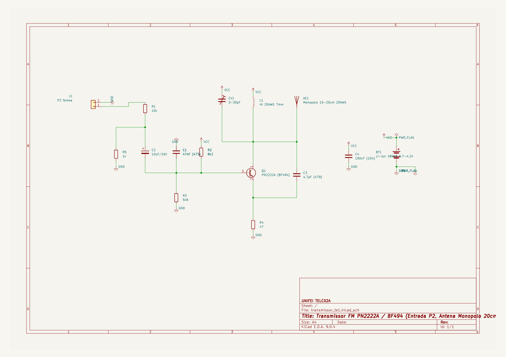

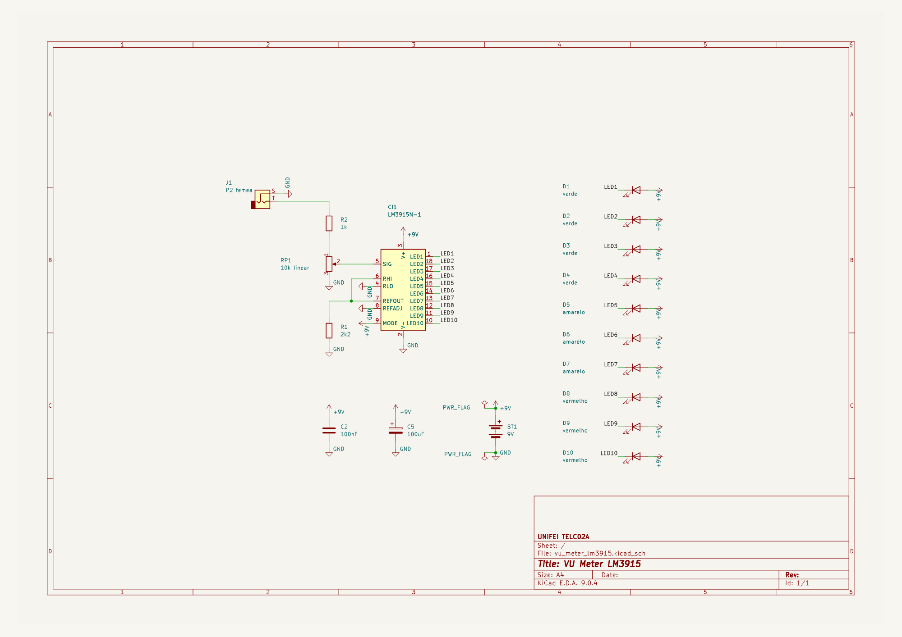

## 3. Lista de Materiais

### 3.1 Circuito A — Transmissor FM VHF
| Designador | Componente | Especificação Técnica | Função no Circuito |
|---|---|---|---|
| `Q1` | Transistor NPN `PN2222A` | Encapsulamento TO-92, $f_T = 300\ \text{MHz}$, substituto do `BF494` | Elemento ativo do oscilador Colpitts e modulador FM |
| `J1` | Conector de áudio P2 fêmea | Diâmetro de 3,5 mm para montagem em placa | Entrada de sinal de áudio em nível de linha |
| `R1` | Resistor de filme de carbono | $10\ \text{k}\Omega$, $1/4\ \text{W}$, tolerância de $5\%$ | Ramo série do divisor atenuador de entrada |
| `R5` | Resistor de filme de carbono | $1\ \text{k}\Omega$, $1/4\ \text{W}$, tolerância de $5\%$ | Ramo em derivação para o terra do divisor de entrada |
| `R2` | Resistor de filme de carbono | $8{,}2\ \text{k}\Omega$, $1/4\ \text{W}$, tolerância de $5\%$ | Ramo superior da rede de polarização de base |
| `R3` | Resistor de filme de carbono | $5{,}6\ \text{k}\Omega$, $1/4\ \text{W}$, tolerância de $5\%$ | Ramo inferior da rede de polarização de base |
| `R4` | Resistor de filme de carbono | $47\ \Omega$, $1/4\ \text{W}$, tolerância de $5\%$ | Degeneração e estabilização DC de emissor |
| `C1` | Capacitor cerâmico disco | $47\ \text{nF}$, código `473` | Aterramento de radiofrequência da base para `GND` |
| `C2` | Capacitor eletrolítico radial | $10\ \mu\text{F} / 16\ \text{V}$ | Acoplamento AC do sinal de áudio para a base |
| `C3` | Capacitor cerâmico disco | $4{,}7\ \text{pF}$, código EIA `479` | Realimentação positiva entre coletor e emissor |
| `C4` | Capacitor cerâmico disco | $100\ \text{nF}$, código `104` | Desacoplamento do barramento de alimentação |
| `CV1` | Capacitor variável trimmer | Faixa de ajuste de $3\ \text{pF}\text{ a }30\ \text{pF}$ | Sintonia de frequência do circuito tanque |
| `L1` | Indutor com núcleo de ar | 4 espiras de fio esmaltado 20 AWG em forma de $7\ \text{mm}$ | Indutância do circuito tanque ressonante de coletor |
| `AE1` | Antena monopolo | Segmento de 15 cm a 20 cm de fio de cobre esmaltado 20 AWG | Irradiação da portadora modulada em VHF |
| `BT1` | Célula Li-Ion 18650 e suporte | Tensão nominal de $3{,}7\ \text{V}$, tensão de carga plena de $4{,}2\ \text{V}$ | Fonte de alimentação contínua do transmissor |

### 3.2 Circuito B — Bargraph VU Meter e Sistema de Recepção SDR
| Designador | Componente | Especificação Técnica | Função no Circuito |
|---|---|---|---|
| `CI1` | Circuito integrado `LM3915N-1` | Encapsulamento DIP-18 montado em soquete de 18 pinos | Controlador logarítmico de 10 passos de $3\ \text{dB}$ |
| `D1` a `D10` | 10 LEDs difusos de 5 mm | 4 unidades verdes, 3 amarelas e 3 vermelhas | Indicação visual de nível em modo barra |
| `R1` | Resistor de filme de carbono | $2{,}2\ \text{k}\Omega$, $1/4\ \text{W}$ | Programação da corrente dos LEDs em $5{,}7\ \text{mA}$ |
| `R2` | Resistor de filme de carbono | $1\ \text{k}\Omega$, $1/4\ \text{W}$ | Proteção em série com a entrada de áudio P2 |
| `RP1` | Potenciômetro rotativo linear | $10\ \text{k}\Omega$, perfil linear | Ajuste de sensibilidade da entrada de sinal no pino 5 |
| `C2` | Capacitor cerâmico disco | $100\ \text{nF}$, código `104` | Desacoplamento local nos terminais de alimentação do CI |
| `C5` | Capacitor eletrolítico radial | $100\ \mu\text{F} / 16\ \text{V}$ | Filtragem do barramento de alimentação |
| `J1` | Conector de áudio P2 fêmea | Diâmetro de 3,5 mm | Entrada do áudio demodulado proveniente do receptor |
| `BT1` | Fonte DC / Bateria de $9\ \text{V}$ | Conector jack DC J4 / clip de bateria | Alimentação do circuito bargraph |
| `SDR` | Receptor USB `RTL-SDR` | Controlador `RTL2832U` e sintonizador `Fitipower FC0012` | Recepção e demodulação `WFM` no software `SDR# Studio` |

## 4. Projeto de Layout da Placa de Circuito Impresso no KiCad
O layout da placa de circuito impresso ([transmissor_te1.kicad_pcb](file:///c:/Users/alighieribot/Documents/UNIFEI/TELC02A/prj/kicad/transmissor/transmissor_te1.kicad_pcb)) foi projetado em face simples na camada `B.Cu` com dimensões externas de $46{,}0 \times 30{,}0\ \text{mm}$. Para compatibilidade eletromagnética em VHF e redução de descontinuidades de impedância, todas as mudanças de direção das trilhas foram traçadas com segmentos chanfrados a $45^\circ$ e $135^\circ$, eliminando curvas em ângulo reto.

As larguras das trilhas foram dimensionadas em $1{,}2\ \text{mm}$ para o barramento de alimentação `VCC`, $1{,}0\ \text{mm}$ para o nó de radiofrequência do coletor e conexões de terra, e $0{,}8\ \text{mm}$ para os ramos de áudio e polarização. Toda a área livre da placa foi preenchida com um plano de terra conectado à malha `GND`, mantendo espaçamento de isolamento de $0{,}50\ \text{mm}$ para reduzir o risco de curtos-circuitos após a corrosão química. O circuito foi validado pelas ferramentas de verificação de regras elétricas e de layout do KiCad sem ocorrências de erro.

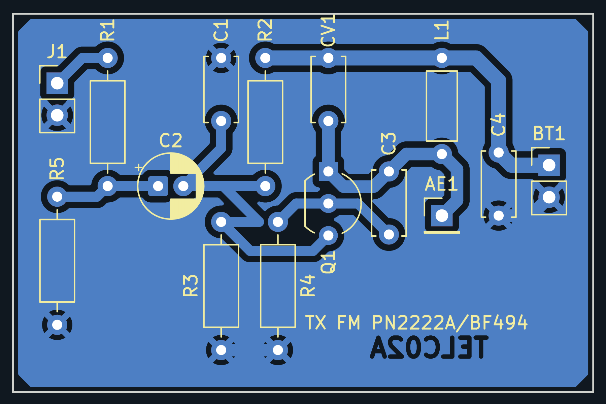

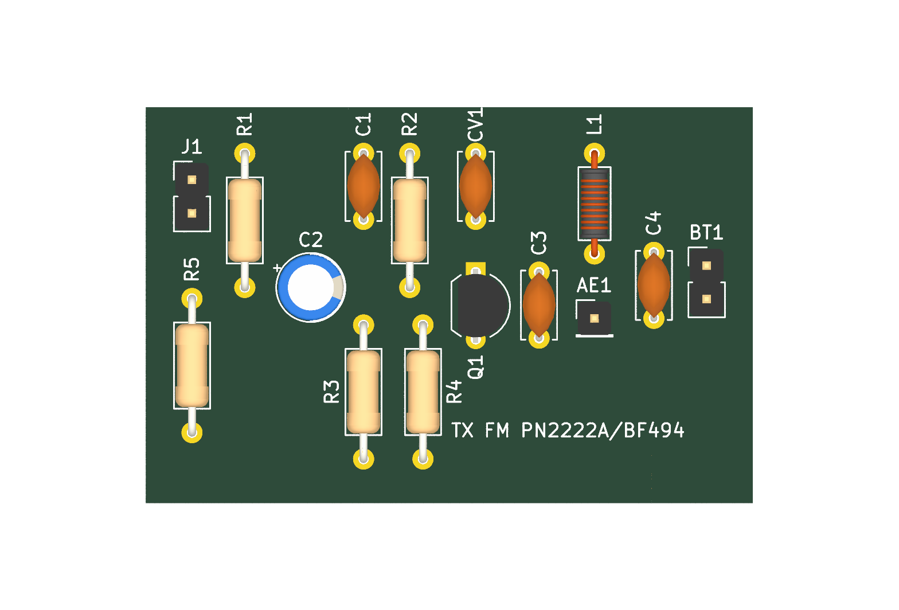

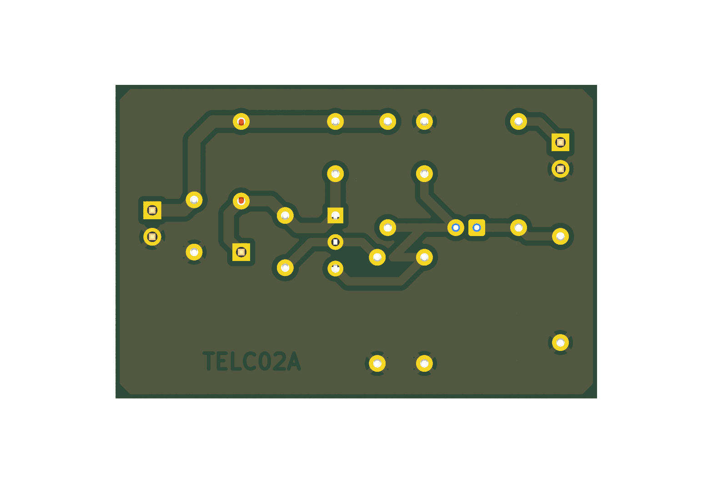

## 5. Impressão, Transferência Térmica, Corrosão e Furação
Para a fabricação pelo método de transferência térmica de toner, o fotolito da camada `B.Cu` e do contorno `Edge.Cuts` foi replicado em uma matriz de $4 \times 4$ cópias em escala $1:1$ sobre folha A4 ([transmissor_te1_toner_transfer.pdf](file:///c:/Users/alighieribot/Documents/UNIFEI/TELC02A/prj/kicad/transmissor/transmissor_te1_toner_transfer.pdf)), permitindo múltiplas transferências a partir de uma única impressão a laser em papel couché. A inscrição vazada `TELC02A` foi incluída na camada de cobre para verificação visual da orientação espelhada após a transferência.

O processo de confecção física seguiu as etapas abaixo:
1. Corte da placa de fenolite cobreada de face simples e limpeza mecânica da superfície de cobre com lã de aço seguida de desengorduramento com álcool isopropílico.
2. Posicionamento do recorte impresso sobre a face cobreada e aplicação de calor e pressão por meio de ferro térmico para adesão do toner ao cobre.
3. Imersão da placa em água para remoção da celulose, mantendo apenas a máscara de toner sobre as trilhas e o plano de terra.
4. Corrosão química em solução de percloreto de ferro até a remoção completa do cobre exposto nas regiões não protegidas pelo toner.
5. Remoção do toner residual com solvente orgânico e execução da furação das ilhas com brocas de $0{,}8\ \text{mm}$ para os terminais de componentes passivos e transistor, e de $1{,}0\ \text{mm}$ para os terminais de maior diâmetro.

## 6. Montagem, Soldagem e Modificações Físicas na Placa
Na etapa de montagem, os componentes foram posicionados e soldados diretamente sobre a face cobreada da placa para encurtar o comprimento dos terminais no circuito de RF e permitir a fixação do suporte da bateria 18650 e do conector P2 fêmea com adesivo termoplástico sobre a base de fenolite.

Durante a soldagem, duas adequações físicas foram executadas e incorporadas ao projeto:
1. **Conexão do Capacitor de Desacoplamento da Base (`C1`) ao `GND`:** O capacitor cerâmico `C1` de $47\ \text{nF}$ foi conectado diretamente entre o terminal da base do transistor e o plano de terra `GND` adjacente aos resistores `R3` e `R4`, reduzindo a indutância parasita do caminho de retorno de RF da base para o terra.
2. **Acoplamento do Indutor `L1` e da Antena `AE1`:** A bobina `L1` foi confeccionada com 4 espiras de fio de cobre esmaltado 20 AWG sobre forma cilíndrica de $7\ \text{mm}$ de diâmetro, tendo o verniz isolante removido nas extremidades antes da soldagem. O fio vertical de 15 cm a 20 cm da antena `AE1` foi soldado diretamente na derivação superior do tanque ressonante.

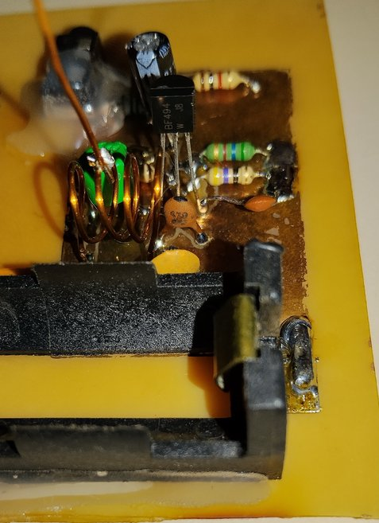

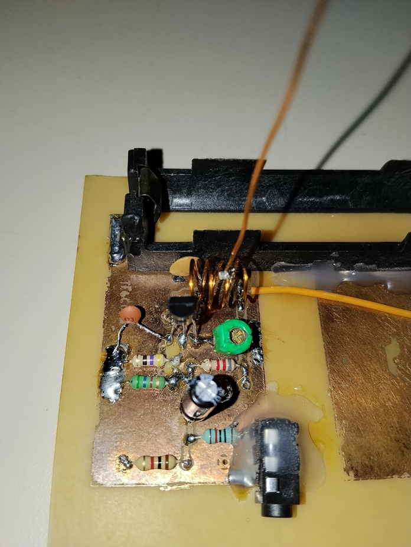

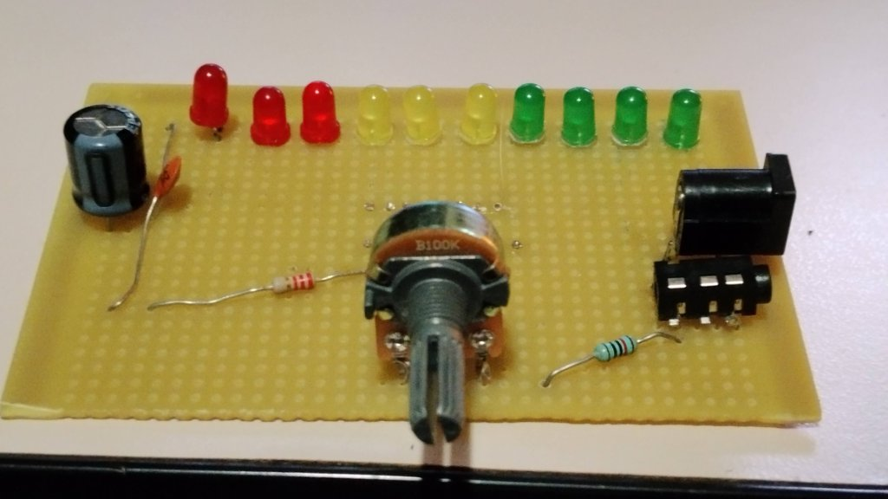

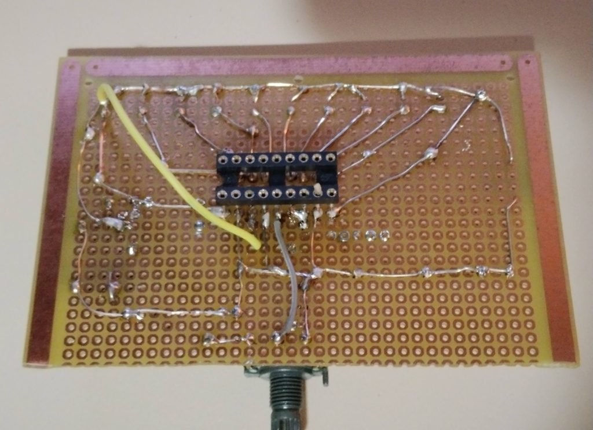

## 7. Testes de Bancada, Substituição do Transistor e Análise com VNA e RTL-SDR
Nos testes iniciais de alimentação com $3{,}7\ \text{V}$ a $4{,}2\ \text{V}$, a montagem equipada com o transistor `BF494` não apresentou oscilação de RF. Após verificação de continuidade das trilhas e das tensões de polarização DC nos terminais de coletor, base e emissor, constatou-se falha no exemplar do `BF494`.

O componente ativo foi substituído pelo transistor bipolar NPN `PN2222A`, cuja frequência de transição é de $300\ \text{MHz}$. Como a distribuição física dos terminais do `PN2222A` segue a ordem Emissor-Base-Coletor, distinta da sequência Coletor-Emissor-Base do `BF494`, os terminais foram adequados à pinagem das ilhas da placa durante a soldagem. Em razão das capacitâncias internas de junção mais elevadas do `PN2222A` em comparação ao `BF494`, a frequência de ressonância do conjunto tanque deslocou-se da faixa comercial de $88\text{ a }108\ \text{MHz}$ para a faixa inferior de VHF.

Para localizar e caracterizar a emissão, utilizou-se inicialmente um Analisador de Rede Vetorial junto a uma rotina de recepção no GNU Radio e, na etapa de sintonia final, um receptor de rádio definido por software `RTL-SDR` com controlador `RTL2832U` e sintonizador `Fitipower FC0012` operado pelo software `SDR# Studio`:

1. **Localização Diferencial da Portadora:** Foram realizadas varreduras espectrais entre $25\ \text{MHz}$ e $115\ \text{MHz}$ comparando o estado do transmissor desenergizado com o estado energizado sem modulação de áudio. A subtração espectral identificou a portadora em $62{,}810\ \text{MHz}$, apresentando relação sinal-ruído superior a $20\ \text{dB}$ acima do piso de ruído de $-42\ \text{dBFS}$.
2. **Otimização da Recepção no SDR#:** O receptor foi configurado em modo `WFM` mono com largura de banda de filtro de $180\ \text{kHz}$ a $340\ \text{kHz}$, taxa de amostragem de $2{,}048\ \text{MSPS}$ em amostragem em quadratura, `Offset Tuning` ativado para eliminação da componente DC central, controles automáticos de ganho `RTL AGC` e `Tuner AGC` desativados para evitar saturação do conversor analógico-digital pelo campo próximo, e ganho manual de RF fixado em $7{,}1\ \text{dB}$.
3. **Verificação da Modulação FM com Sinal de Áudio:** Ao iniciar a reprodução de áudio no aparelho celular conectado à entrada P2 do transmissor, observou-se no analisador de espectro e no espectrograma em cascata do `SDR#` o espalhamento simétrico das bandas laterais de modulação em frequência em torno de $62{,}750\ \text{MHz}$ a $62{,}810\ \text{MHz}$, acompanhando a envoltória dinâmica da música e entregando o sinal de áudio demodulado na saída do receptor.

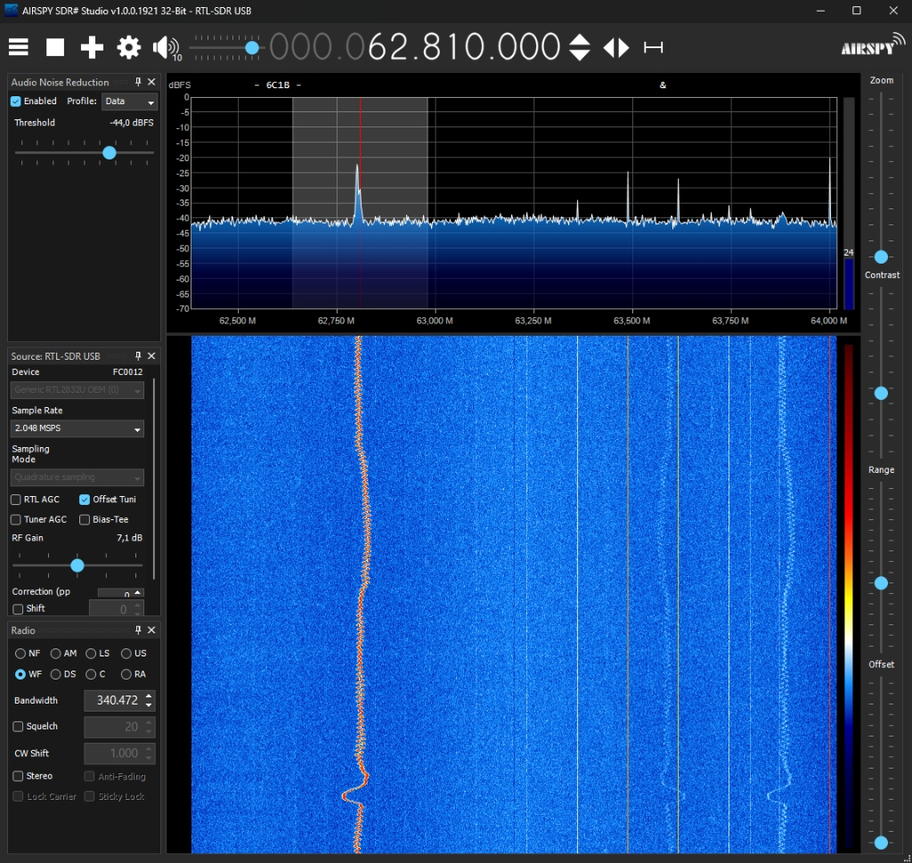

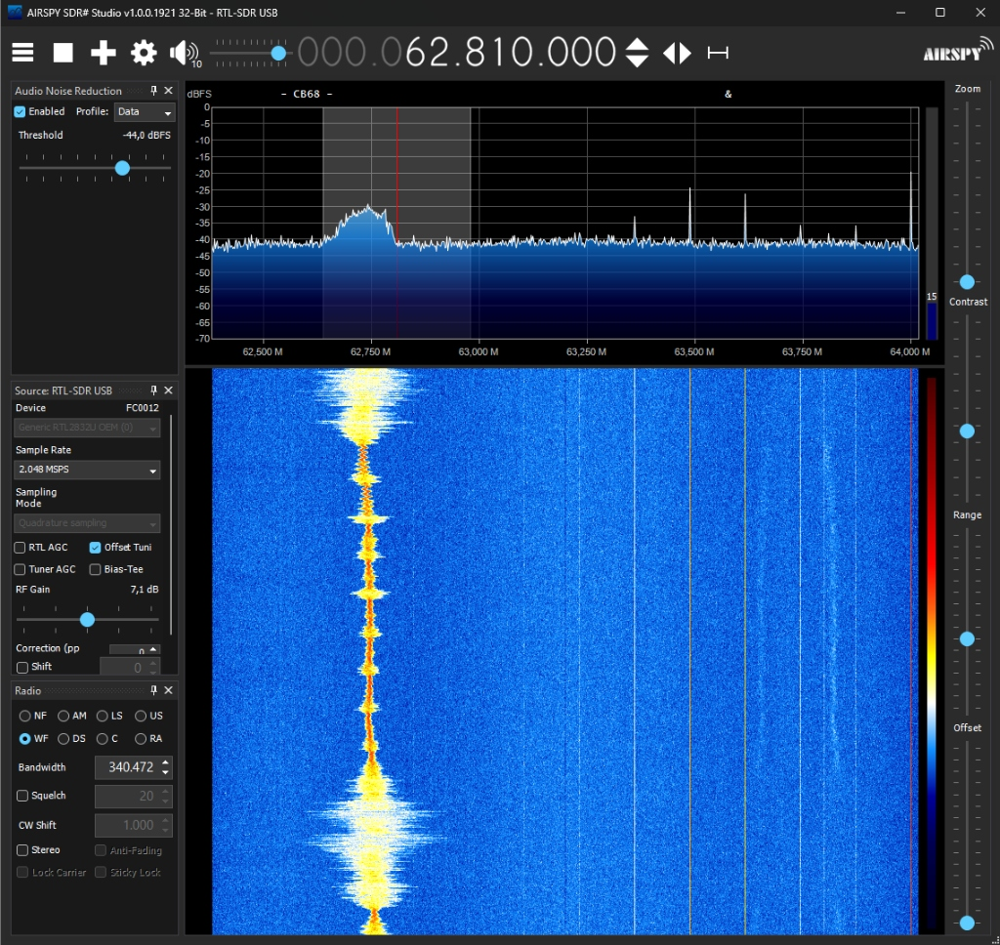
